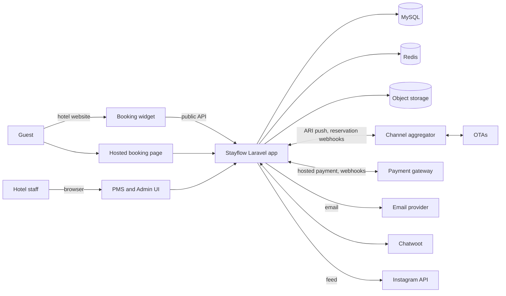
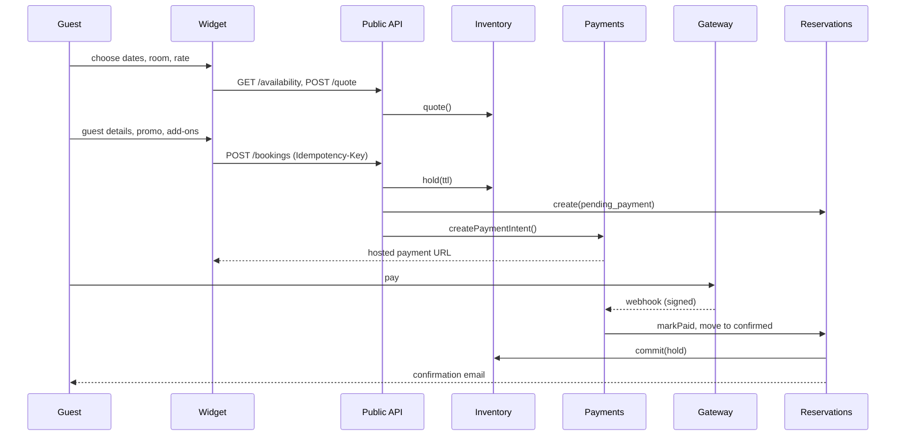
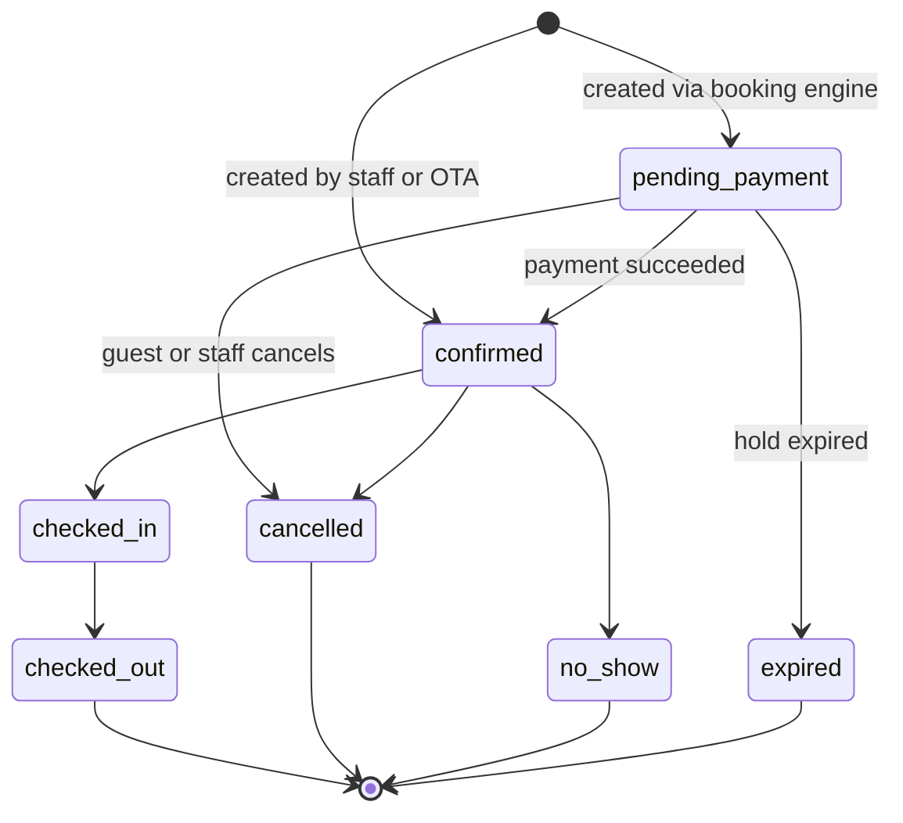
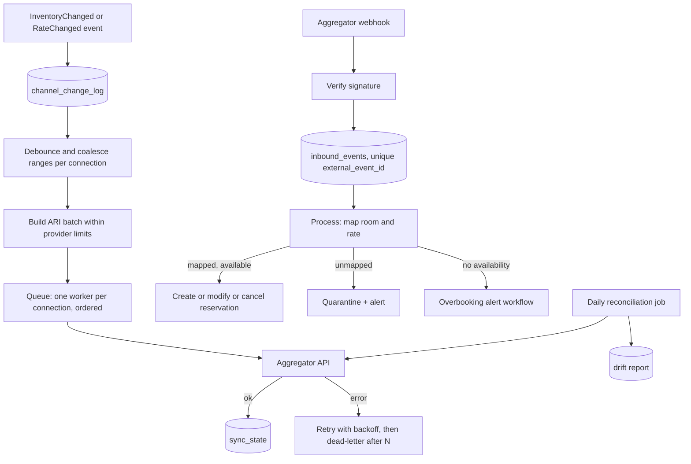
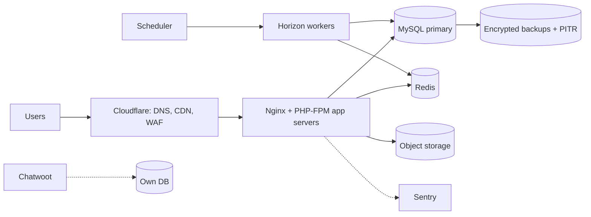

# ARCHITECTURE

Status: **accepted for P1-01…P1-08** — §3 module boundaries, §4 tenancy, §5.1 inventory schema, and §5.2
availability are implemented and tested. §5.3 (`hold()` / `commit()` / `release()`) is **specified but not yet
implemented** — it lands with P1-09, and the concurrency proofs in §5.5 land with P1-10 (both gate M1). §7
booking flow, §8 folio, and §9 distribution remain **proposed** until P2/P4 validate them. Items marked
ADR-xxxx are tracked in `docs/DECISIONS.md`.
Diagrams use Mermaid (render in GitHub or any Mermaid viewer).

## 1. Principles

1. **Correctness first:** inventory counts and money ledgers are never wrong; everything else can be eventually consistent.
2. **Modular monolith** with enforced boundaries (ADR-0001). Extract services only when a measured problem demands it.
3. **Database is the source of truth.** Redis is a cache and queue, never authoritative.
4. **Events at the seams.** Modules publish domain events; other modules subscribe. No cross-module table writes.
5. **Idempotency everywhere** a network, a queue, or a human can repeat a request.
6. **Tenant isolation is a security property**, tested like one.
7. **Boring technology.** Prefer standard Laravel features over custom frameworks.

## 2. System context



## 3. Modules and allowed dependencies

Each module lives in `app/Modules/<Name>` with `Domain`, `Application`, `Infrastructure`, `Http`, `Database`, `Contracts`, `Tests`.
A module may only call another module's `Contracts` (interfaces, DTOs, events). Enforced by architecture tests (P0-10).

| Module | Responsibility | May depend on |
|---|---|---|
| Platform | Organizations, users, RBAC, audit, SaaS billing, settings, feature flags | — |
| Catalog | Properties, room types, room units, media, policies, tax config | Platform |
| Inventory | Rate plans, prices, restrictions, availability, holds | Platform, Catalog |
| Reservations | Reservation aggregate, room assignment, state machine | Platform, Catalog, Inventory, Guests |
| Folio | Ledger, charges, taxes, payments, invoices, night audit postings | Platform, Reservations |
| Housekeeping | Room status, tasks | Platform, Catalog, Reservations (events) |
| Payments | Gateway adapters, payment intents, webhooks, refunds | Platform, Folio |
| Distribution | Channel connections, mappings, ARI push, inbound reservations, reconciliation | Platform, Catalog, Inventory, Reservations |
| BookingEngine | Public API, quotes, promos, add-ons, widget backend | Platform, Catalog, Inventory, Reservations, Payments, Guests, Plugins (contracts) |
| Guests | CRM: profiles, identity resolution, consent, segments, automations | Platform |
| Plugins | Price-match, loyalty, chat bridge, social feed, upsell | Platform, Catalog, Inventory, Guests, BookingEngine (contracts) |
| Reporting | Read models, exports | Read-only queries over other modules' read models; **never writes** |
| Notifications | Mail/WhatsApp channels, templates, delivery log | Platform |

Rules: no dependency cycles; cross-module reads go through contracts; Reporting is the only module allowed
dedicated read queries across tables (via views or read-model classes in its own namespace).

## 4. Multi-tenancy (ADR-0003)

- Hierarchy: `Organization` (customer account) → `Property` (hotel/villa) → everything else.
- **Single database**, shared schema. Every tenant-owned table has `organization_id` (NOT NULL, indexed) and, where applicable, `property_id`.
- A global Eloquent scope (trait `BelongsToTenant`) applies the current organization automatically; raw queries must add the condition explicitly (lint rule + review).
- Authorization is per property through roles (owner, manager, front_desk, housekeeping, revenue, marketing) and Laravel policies.
- Composite unique keys always include the tenant column where uniqueness is tenant-wide.
- **Isolation test suite (P1-01):** for every tenant table, a test proves user A cannot read, update, or delete user B's rows through every entry point (web, API, jobs).
- Support/impersonation access is audited and time-boxed.

## 5. Inventory engine (the core)

### 5.1 Schema (simplified)

```
inventory_days      (organization_id, property_id, room_type_id, date,
                     total_units, held_units, sold_units, blocked_units, updated_at)
                    UNIQUE (room_type_id, date); CHECK total_units >= held_units + sold_units + blocked_units
inventory_holds     (id, organization_id, property_id, idempotency_key UNIQUE, status,
                     reservation_id NULL, expires_at, created_at)
inventory_hold_lines(hold_id, room_type_id, date, units)
rate_plans          (id, property_id, code, name, parent_rate_plan_id NULL, derivation JSON NULL, cancellation_policy_id, ...)
rate_prices         (rate_plan_id, room_type_id, date, amount_minor, currency)    -- plus occupancy adjustments
restrictions_days   (rate_plan_id, room_type_id, date, min_stay, max_stay, cta, ctd, stop_sell)
```

`available = total_units - held_units - sold_units - blocked_units` and is never stored.
Rows are **pre-materialized** by a scheduled job for a rolling window (default 24 months); booking beyond the window is rejected.

### 5.2 Operations (public service: `InventoryService`)

| Operation | Effect |
|---|---|
| `quote(property, room_types, range, occupancy, rate_plan)` | Read-only price and availability; never reserves |
| `hold(request, idempotencyKey, ttl)` | Reserves units temporarily (increments `held_units`) |
| `commit(hold, reservation)` | Converts hold to sold (`held_units`→`sold_units`) |
| `release(hold)` | Returns held units |
| `cancel(reservation)` | Decrements `sold_units` |
| `block/unblock(room_type, range, units, reason)` | Maintenance or manual stop |

### 5.3 Concurrency algorithm

> **Implementation status:** specified only. `hold()` / `commit()` / `release()` and the expiry job land with
> **P1-09**; the concurrency proofs land with **P1-10** (both gate **M1**). See `docs/INVENTORY.md` for what
> P1-08 already ships.

1. `BEGIN`
2. `SELECT … FROM inventory_days WHERE room_type_id IN (…) AND date BETWEEN … ORDER BY room_type_id, date FOR UPDATE` — **always the same order** to avoid deadlocks.
3. Validate availability and restrictions (min/max stay, CTA, CTD, stop-sell) against locked rows.
4. Update counters; insert hold lines.
5. `COMMIT`. Emit `InventoryChanged` **after commit**.
6. On deadlock/lock-wait timeout: retry up to 3 times with jittered backoff; surface a clean "try again" error afterwards.

Idempotency: `idempotency_key` is unique; repeating the call returns the original hold.
Expiry: a scheduled job (every minute, `critical` queue) releases expired holds using the same lock order.
Redis locks may be added only as an optimization to reduce DB contention, never as a correctness mechanism.

### 5.4 Caching

- Availability search results are cached with a short TTL, keyed by property + range + version counter (bumped on `InventoryChanged`).
- Cached data is advisory. `hold()` always re-validates against locked rows.

### 5.5 Acceptance tests (task P1-10)

- 500 concurrent `hold()` calls for the last unit → exactly 1 success.
- Overlapping ranges across many room types → no deadlock reaches the caller; no negative availability.
- Hold expiry returns units exactly once, even if the expiry job runs twice concurrently.
- Property-based test: random sequences of hold/commit/release/cancel keep the invariant.

## 6. Booking flow



Failure paths that must be tested: payment declined, payment webhook delayed, webhook replayed, hold expires before payment,
double-click on "Book", last unit taken by an OTA during payment.

## 7. Reservation state machine



Modifications (dates, room type, guests) are **versioned events** on a reservation, not states. Each transition emits a domain event and
is recorded in the audit log. Illegal transitions throw a domain exception (unit-tested exhaustively).

## 8. Folio and invoices

- **Append-only ledger.** `folio_entries(folio_id, type, amount_minor, currency, business_date, posted_at, reversal_of_id, source, created_by)`; types: `charge`, `tax`, `service_charge`, `payment`, `deposit`, `refund`, `adjustment`.
- Corrections are **reversal entries**, never updates or deletes.
- `balance = SUM(amount_minor)` per folio; property test: any random sequence of valid operations keeps ledger sums consistent.
- **Business date / night audit:** closing a business date posts room charges and locks that date; later fixes post on the open date.
- Invoice numbers are gapless per property, issued inside a transaction using a sequence table with row lock.
- Tax and service charge are configured per property (inclusive/exclusive, percentage, order of application) and snapshotted onto each charge at posting time.

## 9. Distribution (channel manager)



Rules:
- **Outbound ordering:** at most one active push per channel connection; changes carry a monotonically increasing sequence.
- **Inbound idempotency:** keyed by the aggregator's event/reservation id + revision; replays are no-ops.
- **Never silently drop** an inbound reservation: every failure ends in a visible state (quarantined, overbooking, failed with replay).
- **Circuit breaker** per connection (pause pushes after repeated failures, alert, resume manually or automatically after health check).
- **Reconciliation:** daily compare of internal availability/rates vs the channel's; write a drift report; optional auto-heal behind a feature flag.
- Credentials are encrypted at rest; connection health is visible in the sync dashboard (P4-08).

## 10. CRM, consent, tracking

- **Identity resolution:** guests are deduplicated by normalized email and phone; merges are logged and reversible for 30 days (proposal).
- **Consent:** `consents(guest_id, purpose, status, version, source, ip_hash, recorded_at)`; marketing emails and tracking require explicit opt-in where law requires. Data export and deletion requests are workflows with audit trails (Indonesia's PDP law; GDPR for EU guests).
- **Tracking snippet:** loads only after consent where required; sends events to `/collect`; anonymous id is linked to a guest only when the person identifies themselves (booking, chat, login).
- **Automations:** `trigger → conditions → delay → action (email)`; evaluated by scheduled jobs; each send is logged and idempotent.

## 11. Smart plugins

Plugins are modules enabled per property (feature flags) that extend the booking engine through contracts.

- **Price-match:** inputs are our direct price and a **reference OTA price** = the rate we pushed to that channel for the same room/plan/dates + a configurable offset. If `reference < direct`, the gap is within `max_delta_percent`, and the result stays above a configured floor, the widget offers the matched price. Every offer is recorded in `price_match_events`. Limitation: OTA-side promotions can make the guest-visible price differ; hence the offset. Third-party rate data is a later, licensed addition (no scraping).
- **Loyalty:** points ledger (append-only) with tiers; benefits auto-applied via the promo engine contract.
- **Chat:** Chatwoot bridge with signed visitor identity; offline fallback to email.
- **Social feed:** background job refreshes tokens and caches the latest posts; the page never calls Meta directly.
- **Upsell/promos:** promo codes, seasonal discounts, add-on packages, shared engine with the booking flow.

## 12. API surfaces

| Surface | Auth | Notes |
|---|---|---|
| PMS/Admin (Inertia, Filament) | Session + 2FA, role policies | CSRF, rate limits on auth |
| Public booking API `/api/public/v1` | Per-property public key + CORS allow-list; sensitive steps use short-lived signed tokens | OpenAPI spec; `Idempotency-Key` header on mutating calls; RFC 7807 problem responses |
| Webhooks `/webhooks/{provider}` | Signature verification (and IP allow-list if offered) | Store raw payload, process async |
| Widget loader `/widget/v1/loader.js` | None (static, cacheable) | Versioned URL; never breaks existing installs |

## 13. Queues and scheduling

| Queue | Used for | Notes |
|---|---|---|
| `critical` | Payment webhooks, hold expiry | Highest priority, small payloads |
| `distribution` | ARI pushes, inbound reservation processing | Per-connection ordering (`WithoutOverlapping` by connection key) |
| `default` | General jobs | |
| `emails` | Transactional + automation emails | Rate-limited per provider |
| `low` | Reports, imports, reconciliation, media | |

All jobs: idempotent, bounded retries with backoff, failure handler that alerts, unique keys where duplicates are harmful.

## 14. Security architecture

- Authentication: password + TOTP 2FA for staff roles; magic link for guest loyalty login.
- Authorization: policies on every model action; "forbidden" tests required for every endpoint.
- Data: encrypted casts for sensitive guest fields (ID numbers, notes flagged sensitive); encryption keys managed outside the repo; backups encrypted.
- Transport and headers: HTTPS only, HSTS, strict CSP (widget needs a documented allow-list), secure cookies.
- Abuse protection: rate limiting per IP and per property key; Turnstile on booking submit; webhook endpoints rate-limited separately.
- Payments: hosted gateway pages only → PCI SAQ-A scope.
- Supply chain: dependency audit and secret scanning in CI.
- Logging: no PII or secrets in logs; request IDs for traceability.

## 15. Observability

- Structured JSON logs with `request_id`, `organization_id`, `property_id`.
- Sentry for errors; Horizon for queues; Pulse for app health.
- **Business alerts (page someone):** inventory drift detected, sync failing > N minutes, inbound reservation quarantined/overbooking, payment webhook failures, hold-expiry job stalled, queue depth beyond threshold.
- Uptime checks for app, public API, widget loader, webhook endpoints. Public status page.

## 16. Deployment topology



- Staging mirrors production topology at smaller scale.
- Zero-downtime deploys (release directories + health check + automatic rollback).
- Database migrations are backward compatible with the previous release (expand → migrate → contract).

## 17. Non-functional targets (proposed; validate in P6-01 with pilot data)

| Area | Target |
|---|---|
| Availability search | p95 < 500 ms (cached), < 1.5 s (uncached) |
| Hold creation | p95 < 400 ms under concurrent load on the same room type |
| Webhook ack | < 1 s (processing async) |
| ARI propagation to aggregator | Typically within 1–2 minutes of a change |
| Recovery | RPO ≤ 15 minutes, RTO ≤ 4 hours (confirm with pilot expectations) |
| Uptime SLA | **99.5% monthly** (per OQ-09, single-region deployment; revisit if pilot later requires multi-region) |
| Widget size | Budget set in ADR-0007 (gzipped) |
| Accessibility | WCAG 2.1 AA on guest-facing UI |
