# ERD — entity relationship diagram

The diagram below is generated from the schema by `php artisan schema:erd`.
It is checked by `tests/Feature/Platform/ErdDocumentTest.php`: when the
schema changes and this document does not, the test suite fails.

The logical model (the entities, the invariants and the report
definitions) is in `docs/DOMAIN_MODEL.md`.

The types are logical, not physical: `id` and `ref` are the keys, `text`
covers the JSON payloads, and the diagram is the same whether it was
drawn from SQLite or from MySQL.

```mermaid
erDiagram
    amenities {
        int id PK
        ref organization_id FK
        ref property_id FK
        string code
        string name
        string category
        string icon
        datetime created_at
        datetime updated_at
    }
    audit_logs {
        int id PK
        ref organization_id FK
        ref property_id FK
        ref actor_id FK
        string event
        string subject_type
        ref subject_id
        text old_values
        text new_values
        text metadata
        datetime created_at
    }
    billing_events {
        int id PK
        ref organization_id FK
        string gateway UK
        string reference UK
        string type
        datetime created_at
        datetime updated_at
    }
    catalog_media {
        int id PK
        ref organization_id FK
        ref property_id FK
        string mediable_type
        ref mediable_id
        string disk
        string file_path
        string file_name
        string mime_type
        int file_size
        int width
        int height
        text caption
        int sort_order
        int is_primary
        datetime created_at
        datetime updated_at
    }
    inventory_blocks {
        int id PK
        ref organization_id FK
        ref property_id FK
        ref room_type_id FK
        date start_date
        date end_date
        int units
        string reason
        int created_by FK
        datetime created_at
        datetime updated_at
    }
    inventory_days {
        int id PK
        ref organization_id FK
        ref property_id FK
        ref room_type_id FK
        date date UK
        int total_units
        int held_units
        int sold_units
        int blocked_units
        datetime created_at
        datetime updated_at
    }
    inventory_hold_lines {
        int id PK
        ref organization_id FK
        ref hold_id FK
        ref property_id FK
        date date UK
        int units
        datetime created_at
        datetime updated_at
    }
    inventory_holds {
        int id PK
        ref organization_id FK
        ref property_id FK
        ref room_type_id FK
        date check_in
        date check_out
        int units
        string status
        string idempotency_key UK
        datetime expires_at
        ref reservation_id
        datetime committed_at
        datetime released_at
        datetime expired_at
        string release_reason
        datetime created_at
        datetime updated_at
    }
    login_attempts {
        int id PK
        string email
        string ip_address
        text user_agent
        int successful
        string failure_reason
        ref user_id FK
        datetime attempted_at
    }
    memberships {
        int id PK
        ref user_id FK
        ref organization_id FK
        ref property_id FK
        string role
        datetime created_at
        datetime updated_at
        datetime deleted_at
        int property_id_key UK
    }
    notification_deliveries {
        int id PK
        ref organization_id FK
        ref property_id FK
        string channel
        string template
        string locale
        string recipient
        string status
        ref provider_message_id
        string error
        datetime delivered_at
        datetime created_at
        datetime updated_at
    }
    organizations {
        int id PK
        string name
        string slug UK
        string status
        string default_locale
        text settings
        datetime created_at
        datetime updated_at
        datetime deleted_at
    }
    password_reset_tokens {
        string email PK
        string token
        datetime created_at
    }
    properties {
        int id PK
        ref organization_id FK
        string name
        string slug UK
        string status
        datetime created_at
        datetime updated_at
        datetime deleted_at
        string timezone
        string currency
        string check_in_time
        string check_out_time
        string email
        string phone
        text address
        text description
    }
    property_amenities {
        ref property_id PK
        ref amenity_id PK
    }
    property_policies {
        int id PK
        ref organization_id FK
        ref property_id FK
        string type UK
        string title
        text description
        text structured_terms
        int is_active
        datetime created_at
        datetime updated_at
    }
    rate_plans {
        int id PK
        ref organization_id FK
        ref property_id FK
        string code UK
        string name
        text description
        string meal_plan
        ref cancellation_policy_id FK
        ref parent_rate_plan_id FK
        string derivation_type
        int derivation_value
        int is_active
        int sort_order
        datetime created_at
        datetime updated_at
        datetime deleted_at
    }
    rate_prices {
        int id PK
        ref organization_id FK
        ref property_id FK
        ref rate_plan_id FK
        ref room_type_id FK
        date date UK
        int base_price_minor
        string currency
        int extra_adult_price_minor
        int extra_child_price_minor
        datetime created_at
        datetime updated_at
    }
    restrictions_days {
        int id PK
        ref organization_id FK
        ref property_id FK
        ref rate_plan_id FK
        ref room_type_id FK
        date date UK
        int min_stay
        int max_stay
        int cta
        int ctd
        int stop_sell
        datetime created_at
        datetime updated_at
    }
    room_type_amenities {
        ref room_type_id PK
        ref amenity_id PK
    }
    room_types {
        int id PK
        ref organization_id FK
        ref property_id FK
        string code UK
        string name
        text description
        int base_occupancy
        int max_adults
        int max_children
        int total_units
        string status
        datetime created_at
        datetime updated_at
        datetime deleted_at
    }
    room_units {
        int id PK
        ref organization_id FK
        ref property_id FK
        ref room_type_id FK
        string number UK
        string floor
        string bed_config
        string status
        int is_active
        text notes
        datetime created_at
        datetime updated_at
        datetime deleted_at
    }
    sessions {
        string id PK
        ref user_id
        string ip_address
        text user_agent
        text payload
        int last_activity
    }
    subscription_invoices {
        int id PK
        ref organization_id FK
        ref subscription_id FK
        int amount_minor
        string currency
        string status
        string period_reference UK
        datetime period_ends_at
        datetime paid_at
        string failure_reason
        datetime created_at
        datetime updated_at
    }
    subscriptions {
        int id PK
        ref organization_id FK
        string plan
        string status
        datetime trial_ends_at
        datetime current_period_ends_at
        string gateway
        string gateway_reference
        datetime canceled_at
        datetime created_at
        datetime updated_at
    }
    tax_rules {
        int id PK
        ref organization_id FK
        ref property_id FK
        string name
        string kind
        int rate_bps
        int is_inclusive
        string applies_to
        int order
        int is_active
        datetime created_at
        datetime updated_at
    }
    users {
        int id PK
        string name
        string email UK
        datetime email_verified_at
        string password
        string remember_token
        datetime created_at
        datetime updated_at
        text two_factor_secret
        text two_factor_recovery_codes
        datetime two_factor_confirmed_at
        datetime last_login_at
        string last_login_ip
        int failed_login_count
        datetime locked_until
    }
    properties ||--o{ amenities : "property_id"
    organizations ||--o{ amenities : "organization_id"
    users ||--o{ audit_logs : "actor_id"
    properties ||--o{ audit_logs : "property_id"
    organizations ||--o{ audit_logs : "organization_id"
    organizations ||--o{ billing_events : "organization_id"
    properties ||--o{ catalog_media : "property_id"
    organizations ||--o{ catalog_media : "organization_id"
    users ||--o{ inventory_blocks : "created_by"
    room_types ||--o{ inventory_blocks : "room_type_id"
    properties ||--o{ inventory_blocks : "property_id"
    organizations ||--o{ inventory_blocks : "organization_id"
    room_types ||--o{ inventory_days : "room_type_id"
    properties ||--o{ inventory_days : "property_id"
    organizations ||--o{ inventory_days : "organization_id"
    properties ||--o{ inventory_hold_lines : "property_id"
    inventory_holds ||--o{ inventory_hold_lines : "hold_id"
    organizations ||--o{ inventory_hold_lines : "organization_id"
    room_types ||--o{ inventory_holds : "room_type_id"
    properties ||--o{ inventory_holds : "property_id"
    organizations ||--o{ inventory_holds : "organization_id"
    users ||--o{ login_attempts : "user_id"
    properties ||--o{ memberships : "property_id"
    organizations ||--o{ memberships : "organization_id"
    users ||--o{ memberships : "user_id"
    properties ||--o{ notification_deliveries : "property_id"
    organizations ||--o{ notification_deliveries : "organization_id"
    organizations ||--o{ properties : "organization_id"
    amenities ||--o{ property_amenities : "amenity_id"
    properties ||--o{ property_amenities : "property_id"
    properties ||--o{ property_policies : "property_id"
    organizations ||--o{ property_policies : "organization_id"
    rate_plans ||--o{ rate_plans : "parent_rate_plan_id"
    property_policies ||--o{ rate_plans : "cancellation_policy_id"
    properties ||--o{ rate_plans : "property_id"
    organizations ||--o{ rate_plans : "organization_id"
    room_types ||--o{ rate_prices : "room_type_id"
    rate_plans ||--o{ rate_prices : "rate_plan_id"
    properties ||--o{ rate_prices : "property_id"
    organizations ||--o{ rate_prices : "organization_id"
    room_types ||--o{ restrictions_days : "room_type_id"
    rate_plans ||--o{ restrictions_days : "rate_plan_id"
    properties ||--o{ restrictions_days : "property_id"
    organizations ||--o{ restrictions_days : "organization_id"
    amenities ||--o{ room_type_amenities : "amenity_id"
    room_types ||--o{ room_type_amenities : "room_type_id"
    properties ||--o{ room_types : "property_id"
    organizations ||--o{ room_types : "organization_id"
    room_types ||--o{ room_units : "room_type_id"
    properties ||--o{ room_units : "property_id"
    organizations ||--o{ room_units : "organization_id"
    subscriptions ||--o{ subscription_invoices : "subscription_id"
    organizations ||--o{ subscription_invoices : "organization_id"
    organizations ||--o{ subscriptions : "organization_id"
    properties ||--o{ tax_rules : "property_id"
    organizations ||--o{ tax_rules : "organization_id"
```

<!-- BEGIN GENERATED -->

## Tables

| Table | Module |
|---|---|
| `amenities` | catalog |
| `audit_logs` | platform |
| `billing_events` | *(no model)* |
| `catalog_media` | catalog |
| `inventory_blocks` | inventory |
| `inventory_days` | inventory |
| `inventory_hold_lines` | inventory |
| `inventory_holds` | inventory |
| `login_attempts` | platform |
| `memberships` | platform |
| `notification_deliveries` | *(no model)* |
| `organizations` | platform |
| `password_reset_tokens` | *(no model)* |
| `properties` | catalog |
| `property_amenities` | *(no model)* |
| `property_policies` | catalog |
| `rate_plans` | inventory |
| `rate_prices` | inventory |
| `restrictions_days` | inventory |
| `room_type_amenities` | *(no model)* |
| `room_types` | catalog |
| `room_units` | catalog |
| `sessions` | *(no model)* |
| `subscription_invoices` | *(no model)* |
| `subscriptions` | *(no model)* |
| `tax_rules` | catalog |
| `users` | *(no model)* |

The tables marked *(no model)* have no Eloquent model yet: `billing_events`, `notification_deliveries`, `password_reset_tokens`, `property_amenities`, `room_type_amenities`, `sessions`, `subscription_invoices`, `subscriptions`, `users`.
<!-- END GENERATED -->

## Notes

The diagram is the physical schema. The logical model — what each entity
means, the invariants it must hold and the report definitions — is in
`docs/DOMAIN_MODEL.md`.

Two things a reviewer should look at:

- `memberships.property_id` is nullable and the membership survives the
  deletion of a property (`ON DELETE SET NULL`).
- `inventory_holds.reservation_id` has no foreign key on purpose: the
  `reservations` table lands with the Reservations module (P2-01) and the
  constraint is added there.
- `audit_logs.subject_id` points at the audited row without a foreign key:
  the log entry has to stay meaningful even when the subject is deleted.

## Sign-off

The generated part above is checked by
`tests/Feature/Platform/ErdDocumentTest.php`, so it always describes the
schema that exists. The sign-off below is the human part of task `P0-03`.

| Reviewer | Date | Result | Notes |
|---|---|---|---|
| | | | |
